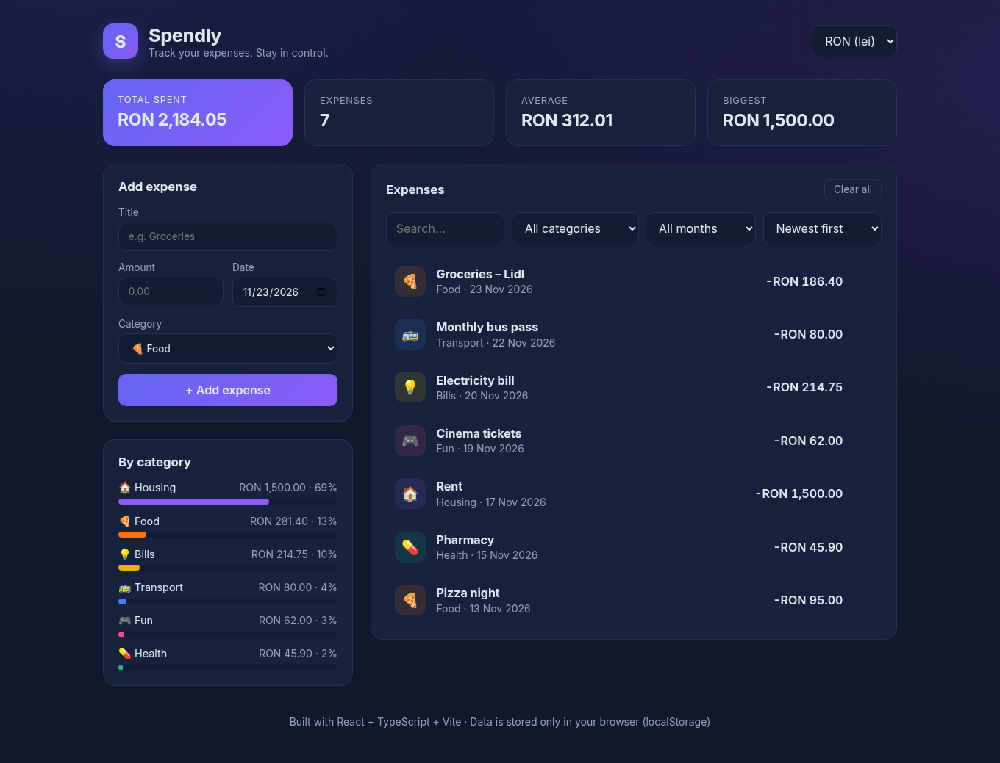

# Spendly – Expense Tracker

A clean, responsive expense tracker built with **React 19**, **TypeScript** and **Vite**.
Add expenses, filter and sort them, and see where your money goes. All data stays in your browser (`localStorage`). No account, no server.

**Live demo:** https://davidgeorgeconstantin-spec.github.io/spendly/



## Features

- ➕ Add and delete expenses, with form validation
- 🏷️ 7 categories with icons and colors
- 🔍 Search, filter by category and month, sort by date or amount
- 📊 Summary cards (total, count, average, biggest) and a per-category breakdown chart
- 💱 Currency switch: RON / EUR / USD
- 💾 Data saved automatically in `localStorage` (survives a page refresh)
- 📱 Fully responsive, keyboard-friendly and accessible labels

## Tech stack

| Area | Tools |
|---|---|
| UI | React 19 (function components and hooks) |
| Language | TypeScript (strict mode) |
| Build tool | Vite |
| Styling | Plain CSS with custom properties (no UI library) |
| Linting | oxlint |

## What I practiced

- Splitting the UI into small, typed, reusable components
- Managing state with `useState`, and lifting state up to a common parent
- Deriving data (totals, filtered and sorted lists) with `useMemo` instead of duplicating state
- Immutable updates (`[...prev]`, `filter`, object spread)
- A generic custom hook, `useLocalStorage<T>`, built on `useEffect`
- TypeScript interfaces, union types and generics

## Getting started

```bash
git clone <this-repo-url>
cd 01-expense-tracker
npm install
npm run dev       # http://localhost:5173
```

Other scripts:

```bash
npm run build     # type-check + production build into dist/
npm run preview   # serve the production build locally
npm run lint      # run oxlint
```

## Project structure

```
src/
├── App.tsx                 # app state, derived data, layout
├── types.ts                # shared TypeScript types and categories
├── components/             # Header, SummaryCards, ExpenseForm, FilterBar,
│                           # ExpenseList, ExpenseItem, CategoryBreakdown
├── hooks/useLocalStorage.ts
├── utils/format.ts         # money and date formatting helpers
└── data/sample.ts          # demo data shown on first visit
```

## Roadmap

- [ ] Edit an existing expense
- [ ] Export to CSV
- [ ] Monthly budget with a progress bar
- [ ] Light / dark theme toggle

## Author

**David Constantin**, junior web developer
Portfolio: https://davidgeorgeconstantin-spec.github.io/ · GitHub: [@davidgeorgeconstantin-spec](https://github.com/davidgeorgeconstantin-spec)
